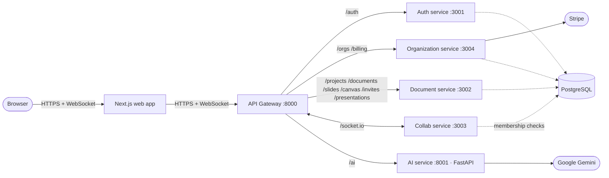
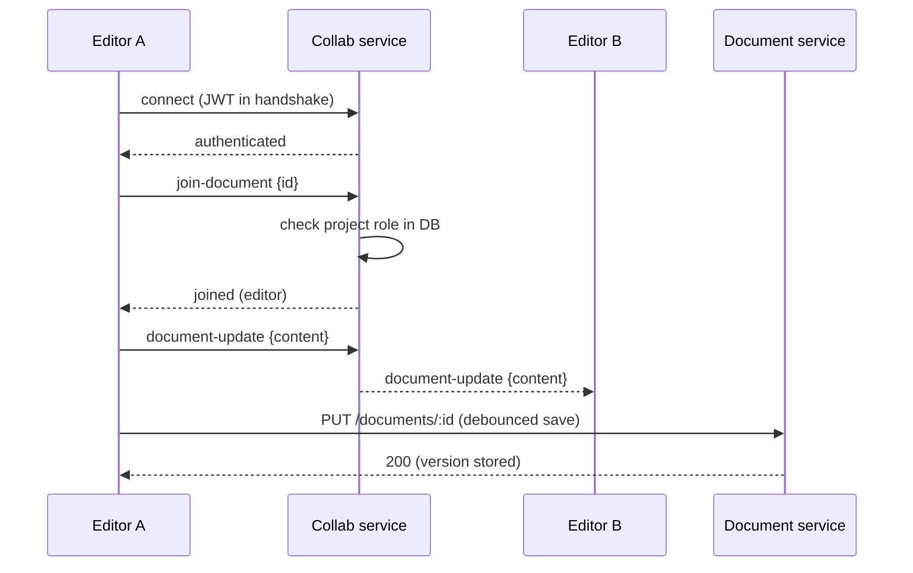

# SynergySpace — Design

This document explains how SynergySpace is put together and, more importantly, **why**. Every major choice is written as a decision record: the context, what was chosen, what was rejected, and what it costs. Where the system is weaker than it could be, that is stated plainly.

> Companion documents: [README.md](README.md) (what it is and how to run it) · [JOURNEY.md](JOURNEY.md) (why it was built and how) · [docs/](docs/) (API reference, security notes, payment flow, setup).

---

## 1. Goals and non-goals

**The primary goal was to build a real microservices system, end to end, and run it in production.** The collaboration product is the vehicle: it is complex enough to justify several services (auth, tenancy, content, real-time, AI, billing each have different shapes of load and different failure modes) while still being something one developer can ship.

| Goals | Non-goals (for now) |
|---|---|
| Clear service boundaries with one owner per domain | Independent databases per service |
| A single public entry point (gateway) | Multi-region / high availability |
| Real-time co-editing with presence | Conflict-free merging (CRDT) and offline mode |
| Authentication enforced in *every* service, not just the edge | A service mesh, mTLS between services |
| AI as an isolated, optional capability | Fine-tuned or self-hosted models |
| Real payments (Stripe) tied to an organization | Usage-based metering |
| Deployable on free-tier infrastructure | Kubernetes |

---

## 2. System overview

| Service | Language | Owns | Talks to |
|---|---|---|---|
| **API Gateway** | Node / Express | Routing, request IDs, CORS, health aggregation | All services |
| **Auth** | Node / Express | Users, password hashes, JWT issue/refresh, verification, reset | PostgreSQL |
| **Organization** | Node / Express | Organizations, members, org roles, Stripe checkout + webhooks | PostgreSQL, Stripe |
| **Document** | Node / Express | Projects, documents, versions, slides, canvases, invites, messages, project roles | PostgreSQL |
| **Collab** | Node / Socket.IO | WebSocket rooms, presence, edit relay, chat fan-out | PostgreSQL (read-only authorization) |
| **AI** | Python / FastAPI | Generation, summarization, autocomplete | Gemini |
| **Web** | Next.js / React | UI, client state, editor | Gateway only |

Shared code lives in `packages/`: `database` (Prisma schema and migrations), `logger` (structured logging) and `types` (shared TypeScript types).

---

## 3. Decisions

### D1 — Split by business domain, not by technical layer

**Context.** The first instinct with "microservices" is to split by layer (an API service, a DB service). That produces services that must all change together for any feature.

**Decision.** One service per domain with a clear owner: identity (Auth), tenancy and money (Organization), content (Document), real-time (Collab), intelligence (AI).

**Why these lines.** Each domain has a different *shape*:
- Auth is small, security-critical and changes rarely — it should be tiny and boring.
- Document is CRUD-heavy and grows with every feature.
- Collab holds thousands of long-lived connections and is CPU-light but memory/connection-heavy — it scales on a completely different axis from REST.
- AI calls a slow, rate-limited, sometimes-unavailable third party, and is best written in Python.
- Billing must be correct and auditable, and is naturally tied to the organization, not the user.

**Rejected.** A modular monolith. It would have been simpler to run, and honestly is the right answer for many teams this size — but the explicit goal was to learn the operational realities of separate services (independent deploys, network hops, distributed auth, partial failure).

**Cost.** More moving parts: six deployables, six sets of env vars, six health checks, and cross-service debugging needs request IDs.

---

### D2 — A single API gateway as the only public surface

**Decision.** The browser knows exactly one backend URL. The gateway (`services/api-gateway`) proxies by path prefix (`/auth`, `/orgs`, `/billing`, `/projects`, `/documents`, `/slides`, `/canvas`, `/invites`, `/presentations`, `/ai`, `/socket.io`) and upgrades WebSocket connections to the Collab service.

**Why.**
- **One CORS policy, one origin** instead of six.
- **Services can move** (port, host, split, merge) without a frontend release — only the gateway's routing table changes.
- **Cross-cutting concerns in one place:** every request gets an `X-Request-ID`, structured logs, and the gateway exposes `/health`, `/ready` and `/live` that aggregate downstream health.

**Rejected.** Letting the frontend call services directly (simpler, one fewer hop, but leaks topology and multiplies CORS/config). A managed gateway (Kong, AWS API Gateway) — powerful but heavy for a free-tier deploy and would hide the very thing being learned.

**Cost.** An extra network hop and a single point of failure (one instance). Acceptable at this scale; the fix later is horizontal replicas behind a load balancer, since the gateway is stateless.

---

### D3 — Authenticate at every service, not only at the edge

**Context.** A common shortcut is "the gateway checks the token, services trust the gateway". That makes every service exploitable the moment anything bypasses the gateway (a misconfigured port, an internal caller, a future service).

**Decision.** The Auth service issues short-lived **access tokens (15 min)** and rotating **refresh tokens**; *every* service that serves user data verifies the JWT itself with the shared secret, and then authorizes against the database:

- Document service checks the caller's **project role** (owner / admin / editor / viewer) on every route.
- Collab service authenticates the **socket handshake** and checks project membership on every `join-document`; viewers join read-only and their edit events are dropped.
- Organization service checks org membership before creating checkout sessions.
- The AI service (Python) verifies the same JWT and applies per-user rate limits and input-size limits.

**Why.** Zero trust between hops is cheap with stateless JWTs — verification is a local HMAC check, no network call to Auth. Authorization stays with the service that owns the data, which is the only place that can answer "can this user touch *this* document?".

**Rejected.** Opaque session tokens with a lookup to Auth on every request (a synchronous dependency on Auth for every call — Auth down means everything down). Gateway-only checks (see context).

**Cost.** A shared signing secret across services. If it leaks, every service is affected; asymmetric keys (Auth signs with a private key, services verify with the public key) are the planned upgrade. Revocation is limited to refresh-token rotation; an access token stays valid until it expires (≤15 min).

---

### D4 — One PostgreSQL database, one shared Prisma schema

**Decision.** All Node services use the same PostgreSQL instance through `packages/database`. Each service only reads and writes the tables of its own domain by convention.

**Why.** A database per service is the textbook answer, but it brings distributed transactions, data duplication and eventual consistency on day one — for a single developer on free-tier hosting, that complexity would have stalled everything else. A shared schema also gives one migration history and type-safe models in every service.

**Rejected.** Database-per-service (correct long-term, premature here). A document store for content (relational fits projects → documents → versions → members well, and Postgres handles text content fine at this size).

**Cost — stated honestly.** This is the system's biggest compromise. Services are *process*-independent but not *data*-independent: a schema change can affect more than one service, and nothing but discipline stops one service from reading another's tables. The migration path is clear: give each service its own schema (Postgres `SCHEMA`) first, then its own database, replacing cross-domain reads with API calls or events.

---

### D5 — Real-time sync: a stateless Socket.IO relay, last-writer-wins

**Decision.** The Collab service keeps **no document state**. Clients join a room per document; an editor's update carries the full new content and is relayed to everyone else in the room, along with cursor/presence events and chat. Persistence goes through the Document service's REST API (`PUT /documents/:id`), which enforces write access.

**Why.**
- **Stateless relay = trivially restartable.** A crashed Collab instance loses nothing; clients reconnect and reload from the Document service.
- **One writer of record.** Only the Document service writes content, so there is a single place for validation, versioning and authorization.
- **Socket.IO** gives rooms, reconnection and transport fallback out of the box.

**Rejected.** A CRDT (Yjs) — the "right" answer for concurrent editing, and `yjs` is already in the dependency tree, but it requires a persistence model for update logs and awareness, and was deferred to get the service boundaries right first. Operational transforms — complex and server-stateful. Raw WebSockets — would mean re-implementing rooms and reconnection.

**Cost.** Concurrent edits to the same document are **last-writer-wins**; there is no merging and no offline mode. Multiple Collab instances would need the Socket.IO Redis adapter to share rooms.

---

### D6 — AI as a separate Python service

**Decision.** Generation, summarization and autocomplete live in `services/ai-service`, a FastAPI app that calls Google Gemini. It sits behind the gateway at `/ai` and verifies the same JWT.

**Why.**
- **Right tool for the job.** Python is where the AI SDKs and tooling are best. Microservices make the language choice per-service instead of per-project — this is the clearest demonstration of that benefit in the codebase.
- **Failure isolation.** LLM calls are slow and the provider can rate-limit or fail. In its own process, a stuck or failing AI call cannot block document saves, sockets or billing.
- **Cost control.** Per-user rate limiting and input caps live in one place, next to the paid API.
- **Mockable.** `MOCK_AI=true` lets the whole product run without a Gemini key.

**Rejected.** Calling Gemini from the browser (exposes the key, no rate limiting). Calling it from the Document service (couples a slow third party to the core write path).

**Cost.** A second language toolchain in CI and deploys. Rate limiting is in-memory, so it resets on restart and does not span instances.

---

### D7 — Billing belongs to the organization, and the webhook is the source of truth

**Decision.** Stripe Checkout sessions are created by the Organization service for an organization (only for its members). The plan is activated **only** by the signed `checkout.session.completed` webhook, verified with Stripe's signing secret — never by the browser's success redirect.

**Why.** Teams pay, not individuals, so subscription state lives on the tenant. Redirects can be faked or never arrive; a signed server-to-server webhook cannot be forged and is retried by Stripe.

**Cost.** Webhooks need a public URL (Stripe CLI in development) and idempotent handling.

---

### D8 — Health, readiness and liveness everywhere

Every service exposes health endpoints; the gateway aggregates them. On free-tier hosting, services sleep when idle, and the web app hits a keep-alive route so the first real request does not pay the full cold start. This is what makes "six services on free hosting" usable at all.

---

### D9 — Tests where a bug would be a breach

**Decision.** Test effort is concentrated on security-critical paths: JWT handling, project role checks, socket handshake and room authorization, Stripe webhook and checkout authorization, AI auth, rate limits and input limits — Jest for Node services, pytest for the AI service, both in GitHub Actions on every push.

**Why.** With limited time, the highest-value tests are the ones guarding the boundaries between services, because that is where microservices most often go wrong.

**Cost.** No frontend or end-to-end tests yet; backend tests run against mocked data access rather than a live database.

---

## 4. Frontend design system

The interface was rebuilt around one idea: **it should feel like a calm, professional tool, and the architecture should be visible in the product's story.**

### Principles
1. **Paper and ink.** Warm off-white surfaces (`#f7f6f2`), near-black ink (`#15171c`), one cobalt accent (`#2f4cdd`). No gradients-on-everything, no neon, no emoji as icons. Colour is reserved for meaning: the accent marks the active thing; status colours (success, warning, destructive) mean exactly that.
2. **Editorial type.** *Instrument Serif* for display headings (with italics for emphasis), *Geist* for UI text, *Geist Mono* for technical labels, ports and routes. The serif gives the brand a voice; the mono ties the UI back to the engineering underneath.
3. **Tokens, not hues.** Every colour is a CSS variable in `apps/web/app/globals.css` (`--background`, `--foreground`, `--accent`, `--accent-soft`, `--presence-1…4`, `--shadow-soft`, `--shadow-lift`, …) exposed to Tailwind via `@theme`. Pages use `bg-card`, `text-muted-foreground`, `bg-accent-soft` — never `bg-indigo-500`. A dark variant of every token exists under `.dark`.
4. **Motion with a job.** Animations explain the product rather than decorate it:
   - The hero re-enacts a real session — remote cursors move, one types, the AI panel streams a reply.
   - The architecture section is an interactive diagram: request packets travel from the gateway to the active service, and hovering a service explains what it owns.
   - Headings reveal line-by-line; cards rise on scroll; everything uses one easing curve (`cubic-bezier(0.22, 1, 0.36, 1)`).
   - `prefers-reduced-motion` disables all of it.
5. **Presence colours are muted and distinct** (cobalt, rust, teal, violet) so several collaborators stay legible without turning the page into a rainbow.

### Landing page structure
| Section | Purpose |
|---|---|
| Hero + live editor mock | Show, in five seconds, what the product does |
| Stack marquee | Signal the technology without a logo wall |
| 01 Product | Documents, slides, canvas, workspaces & roles |
| 02 Architecture | Interactive service diagram + four engineering principles |
| 03 AI | Isolated assistant; real request/response shape through the gateway |
| 04 Billing | Stripe flow, webhook as source of truth |
| Final CTA | One-click demo workspace |

---

## 5. Known limitations and next steps

| Area | Today | Next |
|---|---|---|
| Data ownership | Shared database and schema | Per-service Postgres schemas, then databases |
| Concurrency | Last-writer-wins | Yjs CRDT with persisted update logs |
| Collab scale-out | Single instance | Socket.IO Redis adapter |
| Token signing | Shared HMAC secret | Asymmetric (RS256/EdDSA) keys, JWKS from Auth |
| Rate limiting | In-memory per instance | Redis-backed |
| Inter-service events | Synchronous REST | Event bus for cross-domain changes |
| Email | Links logged, not sent | Transactional email provider |
| Observability | Structured logs + request IDs | Metrics and distributed tracing (OpenTelemetry) |
| Tests | Backend security paths | Frontend and end-to-end tests |
