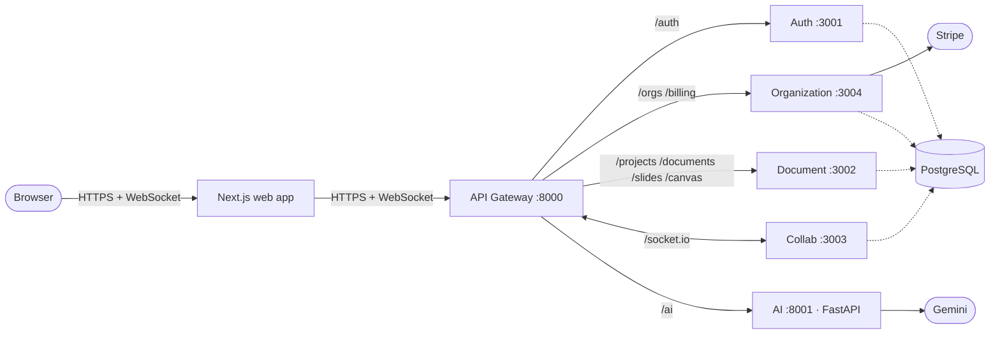

<div align="center">

# SynergySpace

**Write, sketch and present — together, in real time.**

A real-time collaborative workspace for documents, slides and canvases, with live presence, an AI assistant, team workspaces with role-based access, and Stripe billing — **built as six independent services behind one API gateway.**

[Live demo](https://synergyspace-web.vercel.app) · [Design](DESIGN.md) · [Journey](JOURNEY.md) · [API reference](docs/api_reference.md) · [Security](docs/security.md)

</div>

> The demo runs on free-tier hosting, so the first load after idle can take ~30–60 s while the services wake up. Click **Try the live demo** for a pre-filled workspace — no sign-up needed.

---

## Why this project

SynergySpace was built to get real, hands-on experience with **microservices** — not a two-service tutorial, but a complete product split along genuine domain boundaries, deployed to production infrastructure, with authentication enforced across service hops, a polyglot (Node + Python) backend, real-time WebSockets routed through a gateway, and real payments. The story is in [JOURNEY.md](JOURNEY.md); every architectural decision and its trade-offs are in [DESIGN.md](DESIGN.md).

## What it does

- **Live co-editing** — documents, slide decks and a shared canvas, with live cursors, presence and team chat over WebSockets.
- **AI assistance** — generate, summarize and autocomplete, served by a dedicated Python service using Google Gemini.
- **Workspaces & roles** — organizations, projects, email invitations and four project roles (owner / admin / editor / viewer), enforced on every API route **and** every socket room.
- **Versioning** — saved document version snapshots.
- **Auth** — email/password sign-up with verification, short-lived JWT access tokens with rotating refresh tokens, password reset.
- **Billing** — Stripe Checkout per organization, activated only by a signed webhook.

## Architecture

The browser talks to exactly one backend URL. The gateway routes each path to the service that owns it.



| Service | Stack | Responsibility |
|---|---|---|
| `api-gateway` | Express | Single entry point: path routing, WebSocket upgrade, request IDs, CORS, aggregated health |
| `auth-service` | Express | Users, bcrypt hashes, JWT access/refresh tokens, verification, password reset, rate limiting |
| `organization-service` | Express | Organizations, members, org roles, Stripe checkout and webhooks |
| `document-service` | Express | Projects, documents, versions, slides, canvases, invites, messages; project-role checks |
| `collab-service` | Socket.IO | Authenticated rooms, presence, edit relay, chat — stateless, persists via the document service |
| `ai-service` | FastAPI (Python) | Generation, summarization, autocomplete via Gemini; JWT-verified, rate-limited |
| `apps/web` | Next.js, React | The interface — talks to the gateway only |

**Key design decisions** (full reasoning in [DESIGN.md](DESIGN.md)):

1. **Split by business domain**, not by technical layer — each service has one owner and a different scaling shape.
2. **One gateway** as the only public surface, so services can move without frontend changes.
3. **Zero trust between hops** — every service verifies the JWT itself and authorizes against the data it owns.
4. **Polyglot by choice** — Node for I/O and sockets, Python for AI.
5. **Failure isolation** — the AI provider can go down without affecting editing or billing.
6. **Webhook as the source of truth** for billing.

**Honest trade-offs:** services share one PostgreSQL database through a shared Prisma schema (process-independent, not data-independent); concurrent edits are last-writer-wins (no CRDT yet); the gateway, collab service and database are single instances. Each has a documented migration path in [DESIGN.md §5](DESIGN.md#5-known-limitations-and-next-steps).

## Tech stack

| Area | Technologies |
|---|---|
| Frontend | Next.js 16, React 19, TypeScript, Tailwind CSS 4, Framer Motion, TipTap |
| Services | Node.js, Express, TypeScript, Socket.IO |
| AI | Python, FastAPI, Google Gemini |
| Data | PostgreSQL, Prisma |
| Payments | Stripe Checkout + webhooks |
| Quality | Jest, pytest, GitHub Actions CI |
| Hosting | Vercel (web), Render (services + database), Docker |

## Run it locally

**Prerequisites:** Node.js 18+, Python 3.9+, Docker (or a local PostgreSQL). A Gemini key is optional — set `MOCK_AI=true` to run without one.

```bash
git clone https://github.com/likhith1253/Synergy_Space.git
cd Synergy_Space
npm install
```

1. **Database** — `docker compose up -d postgres`
2. **Environment** — in `packages/database`, each `services/*` folder and `apps/web`, copy `.env.example` to `.env` (`.env.local` for the web app). Default ports: gateway 8000, auth 3001, document 3002, collab 3003, organization 3004, AI 8001. Use the **same** `JWT_SECRET` in every service (including the AI service) and a different `JWT_REFRESH_SECRET` in the auth service. Set `ENABLE_DEMO_MODE=true` in the auth service for the one-click demo account.
3. **Schema** — `npm run db:push --workspace @collab/database`
4. **Node services + web app** — `npm run dev`
5. **AI service** (separate terminal):
   ```bash
   cd services/ai-service
   pip install -r requirements.txt
   python -m src.main
   ```

Open http://localhost:3000.

## Tests

```bash
npm test                                   # auth, document, collab, organization services
cd services/ai-service && python -m pytest tests
```

The suites cover the security-critical boundaries between services: JWT handling, project-role checks, socket handshake and room authorization, Stripe webhook and checkout authorization, AI auth, rate limits and input limits. Both run in CI on every push.

## Repository layout

```text
apps/web/                 Next.js frontend (landing page, app, editor)
services/
  api-gateway/            routing, WebSocket upgrade, health aggregation
  auth-service/           identity and tokens
  organization-service/   tenancy and Stripe billing
  document-service/       projects, documents, slides, canvas, invites, messages
  collab-service/         Socket.IO real-time relay and presence
  ai-service/             FastAPI + Gemini
packages/
  database/               Prisma schema and migrations
  logger/  types/         shared libraries
docs/                     API reference, security, payment flow, setup, deployment
DESIGN.md                 architecture and design decisions
JOURNEY.md                why and how it was built
```

## Roadmap

- Yjs CRDT for conflict-free concurrent editing and offline support
- Per-service database schemas, then databases
- Redis for Socket.IO scale-out and shared rate limiting
- Asymmetric token signing with a JWKS endpoint
- Transactional email, metrics and distributed tracing
- Frontend and end-to-end tests

## License

[MIT](LICENSE)
