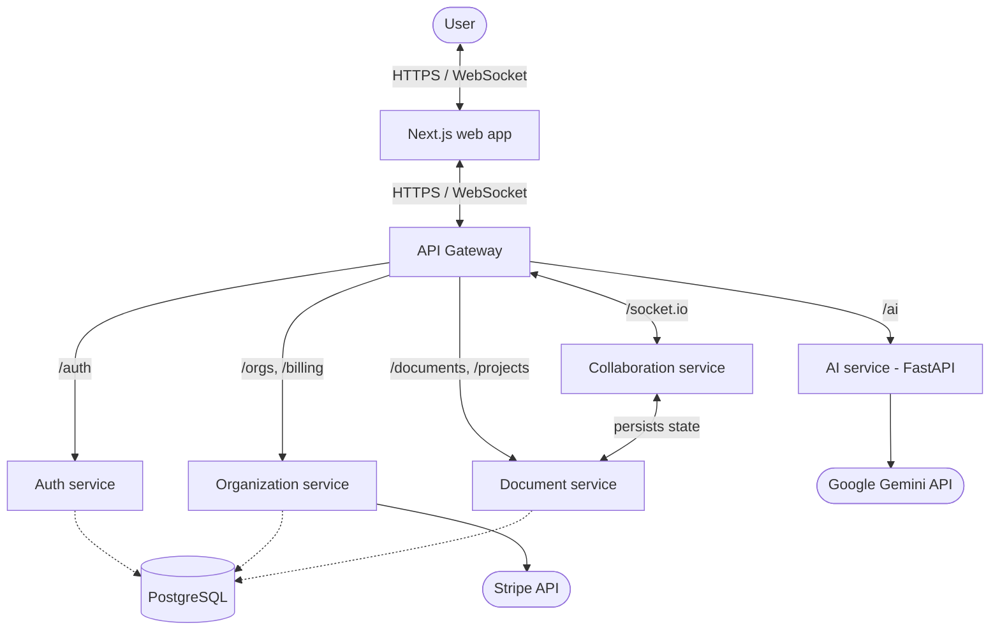

# SynergySpace

A real-time collaborative workspace: multi-user document editing, presentations, canvas and team chat, with AI writing assistance, organizations and role-based access. Built as a microservice monorepo.

**Live demo:** https://synergyspace-web.vercel.app (free-tier hosting, so the first load after idle can take ~30-60 s while the services wake up)

[Features](docs/features.md) · [Architecture](docs/architecture.md) · [Setup](docs/setup.md) · [API reference](docs/api_reference.md) · [Security notes](docs/security.md)

---

## What it does

- **Live co-editing** over WebSockets (Socket.IO): edits are relayed to everyone in the document room, with presence. Updates are whole-content, last-writer-wins (no CRDT merge yet; Yjs is declared as a dependency but not used).
- **AI assistance** (text generation, summarization, autocomplete) served by a separate Python/FastAPI service that calls Google Gemini.
- **Workspaces:** organizations, projects, teams, email invitations, and per-project roles (owner / admin / editor / viewer) enforced on every API route and socket room.
- **Content types:** documents with saved version snapshots, slide presentations, a canvas, and in-app messages.
- **Auth:** email/password sign-up with verification, JWT sessions, password reset. Verification and reset links are currently logged by the auth service instead of emailed (no mail provider is wired up).
- **Billing:** Stripe Checkout from the pricing page, with the subscription tied to the organization.

## Architecture

All client traffic goes through one API gateway that routes to the individual services.



Design notes and honest trade-offs:

- Services share a single PostgreSQL database through a shared Prisma package (`packages/database`). That keeps the project simple to run, but it means the services are not independently deployable data-wise.
- The gateway is a single instance and the database is a single instance, so this is a clean service separation, not a high-availability setup.
- Real-time sync is client-server (clients talk to the collaboration service), not peer-to-peer, and the collaboration service is a stateless relay: content is persisted through the document service's REST API. No latency benchmark has been published yet.

## Screenshots

| Dashboard | Editor | Pricing / checkout |
|:---:|:---:|:---:|
|  |  |  |

## Tech stack

| Area | Technologies |
|---|---|
| Frontend | Next.js, React, TypeScript, Tailwind CSS |
| Backend services | Node.js, Express, TypeScript, Socket.IO |
| AI service | Python, FastAPI, Google Generative AI SDK |
| Data | PostgreSQL, Prisma |
| Payments | Stripe |
| Hosting | Vercel (web), Render (services + database) |

## Run it locally

**Prerequisites:** Node.js 18+, Python 3.9+, PostgreSQL (or Docker), a Gemini API key.

```bash
git clone https://github.com/likhith1253/Synergy_Space.git
cd Synergy_Space
npm install
```

1. **Database.** Start Postgres (`docker compose up -d postgres` uses the included `docker-compose.yml`).
2. **Environment.** In `packages/database`, each service in `services/*`, and `apps/web`, copy `.env.example` to `.env` (for `apps/web`, `.env.local`) and fill it in. Default ports: gateway 8000, auth 3001, document 3002, collab 3003, organization 3004, AI 8001. `apps/web` requires all five `NEXT_PUBLIC_*` URLs listed in its `.env.example` for a production build. The important keys are `DATABASE_URL`, `JWT_SECRET` (the same value in every service that verifies tokens, including the AI service, which rejects requests without a valid token), `JWT_REFRESH_SECRET` (auth service only, must differ), and `GEMINI_API_KEY` for the AI service. Set `ENABLE_DEMO_MODE=true` in the auth service only if you want the one-click demo account. `.env` files are git-ignored.
3. **Schema.**
   ```bash
   npm run db:push --workspace @collab/database
   ```
4. **Node services and web app.**
   ```bash
   npm run dev
   ```
5. **AI service** (separate terminal):
   ```bash
   cd services/ai-service
   pip install -r requirements.txt
   python -m src.main
   ```

Then open http://localhost:3000. Set `MOCK_AI=true` in `services/ai-service/.env` to try the editor without a Gemini key.

## Repository layout

```text
apps/web/                 Next.js frontend
services/
  api-gateway/            routing / proxy
  auth-service/           sign-up, login, JWT, password reset
  collab-service/         Socket.IO relay: auth, room authorization, presence, chat
  document-service/       documents, projects, slides, canvas, messages, invites
  organization-service/   organizations and Stripe billing
  ai-service/             FastAPI + Gemini
packages/
  database/               Prisma schema and migrations
  logger/  types/         shared libraries
docs/                     architecture, API, security, payment flow, setup
```

## Status and roadmap

Known gaps, stated plainly:

- **Tests** cover the security-critical backend paths only (JWT handling, role/ownership checks in the document service, Socket.IO handshake and room authorization, Stripe webhook and checkout authorization, AI endpoint auth and rate limiting). They run against mocked data access, not a live database, and there are no frontend or end-to-end tests. Run them with `npm test` (Node services) and `python -m pytest tests` in `services/ai-service`.
- **No CRDT / offline editing.** Concurrent edits are last-writer-wins; Yjs is not wired in, and offline editing is not implemented.
- **No transactional email** (see above), and rate limiting is in-memory. See [docs/security.md](docs/security.md) for the full list of known limitations.
- **Rich-text AI output** (headings, lists, inline styles) is not implemented; the AI service returns plain text.
- **Observability:** no metrics or tracing beyond structured logs.

## License

[MIT](LICENSE)
