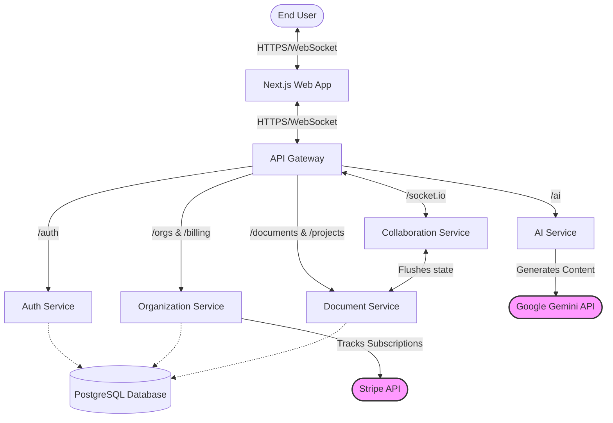

# System Architecture

The SynergySpace platform is built on an API-Gateway-driven microservices architecture. This structure ensures isolation of responsibilities, improved scalability, targeted tech stacks for respective jobs (Node.js vs Python), and resilient fault boundaries.

## Component Breakdown

1. **Frontend (Next.js Application)**
   - Responsible for state management, local CRDT representations (Yjs), and rendering the user interface. Connects to backend services entirely through the API Gateway, utilizing HTTP for standard resource operations and WebSockets for real-time collaboration.

2. **API Gateway (Node.js/Express)**
   - Acts as the single point of entry into the application cluster.
   - Provides HTTP proxying to all downstream components and upgrades WebSocket connections for `collab-service`.
   - Normalizes CORS behavior and implements global request logging and health tracking.

3. **Auth Service (Node.js/Express)**
   - Manages encrypted user credentials (`password_hash`), registration, login flow, and JWT (JSON Web Token) creation/validation. Assumes domain authority over the `User` database tables.

4. **Organization Service (Node.js/Express)**
   - Serves as the tenant isolation layer. Manages Organizations, Team memberships, and underlying ties to user access levels. Contains Stripe abstractions and billing configurations.

5. **Document Service (Node.js/Express)**
   - Central authority over textual and metadata resources including Projects, Documents, Canvases, and Slides. Stores document content (in the `documents.yjs_binary_state` column, currently plain UTF-8 text despite the name) and version snapshots, and enforces project role checks on every route.

6. **Collaboration Service (Node.js/Socket.io)**
   - Authenticates each socket with the JWT, authorizes room joins against project membership in the database, and relays document/slide/canvas updates, presence and chat messages between the members of a room. It keeps no document state and does not write to the database; persistence happens through the `document-service` REST API.

7. **AI Service (Python/FastAPI)**
   - Specialized environment for Natural Language Processing tasks leveraging the Google Generative AI (Gemini) SDK. Integrates directly into the editor context to synthesize real-time user prompts with contextual blocks of the document.

8. **Database Layer (PostgreSQL/Prisma)**
   - Centralized relational database, utilizing Prisma ORM across Node.js services acting as the singular source of truth for durable states. 

9. **Stripe (External Integration)**
   - Facilitates the payment infrastructure. Managed primarily via the Organization Service to maintain subscription ties logically coupled with the tenant object.

## Ecosystem Routing & Data Flow

## Real-Time Collaboration Flow

1. **Initialization:** The client fetches the latest saved content from the `document-service` through the Gateway.
2. **WebSocket Handshake:** A Socket.io connection is opened to the `collab-service` with the access token. Connections without a valid token are rejected.
3. **Join:** The client emits `join-document`; the service checks the caller's role on the owning project and either joins the room (read-only for viewers) or returns a `FORBIDDEN` error.
4. **Broadcasting:** An editor's `document-update` carries the full new content; the service forwards it to the other sockets in the room. Updates from viewers, or from sockets that have not joined the room, are dropped. Concurrent edits are last-writer-wins (no CRDT merge).
5. **Persistence:** The client saves content through the `document-service` REST API (`PUT /documents/:id`), which requires write access.
